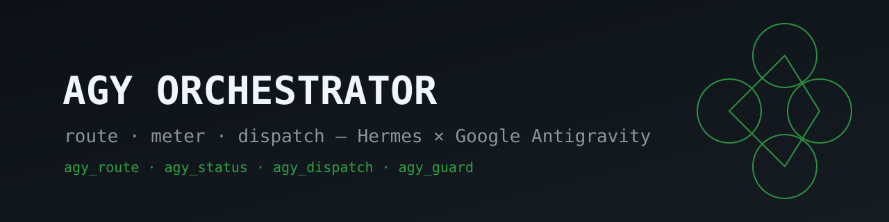

# AGY Orchestrator



[](https://github.com/NousResearch/hermes-agent)
[](LICENSE)
[](https://github.com/BVLCQ/agy-orchestrator/actions/workflows/tests.yml)
[](https://github.com/NousResearch/hermes-agent)

**Orchestrate a Google Antigravity subscription from [Hermes Agent](https://github.com/NousResearch/hermes-agent): route work to your models, meter the quota pools, dispatch runs, guard read-only work.**

Hermes stays the brain on your own provider. AGY Orchestrator sends work *to* the
subscription: chunks get routed to task archetypes, each archetype resolves to a
model **you** picked, every dispatch is metered against its quota pool, and
read-only runs are verified against a git fingerprint. This is the complement of
the Antigravity *provider* plugins (which run Hermes itself on the subscription) —
here the subscription is a second compute pool your agent orchestrates.

## Tools

| Tool | What it does |
|---|---|
| `agy_route` | Classifies task chunks into routes (`plan` / `parallel` / `hermes_delegate`) — keyword heuristic by default (instant, zero deps), calibrated Kev-4B chain opt-in. Optional `route` param pins a whole batch. |
| `agy_status` | Full state: auth expiry, quota snapshot, pool burn (5h + weekly windows), per-model usage, dispatch log, provider telemetry. |
| `agy_dispatch` | **Meter-owned dispatch**: spawns a detached, env-scrubbed agy run; output written by the meter itself (`runs/<slug>__<run_id>.json` — attribution is structural, not a naming convention); list argv (no shell-quoting pitfalls); returns run_id + paths immediately. `readonly=true` records a git baseline. |
| `agy_guard` | Git-fingerprint read-only guard: `phase=before` records a tree baseline (HEAD + porcelain + untracked size/mtime); `phase=after` compares — `CLEAN`, `DRIFT` (with changed files), `NOT_A_REPO`, `NO_BASELINE`. |

## Routes & the model picker

The classifier picks the **route** (task archetype); the **model** comes from your
ordered selection — edited in the desktop pane's picker, stored in
`~/.hermes/cache/agy-orchestrator/settings.json`. **Only selected models are ever
routable.**

| Route | Purpose | Example selection |
|---|---|---|
| `plan` | thinking brain: plans, deep analysis | `claude-opus-5-5-high` → `gemini-4-hydrogen-high` |
| `parallel` | fan-out work: code + bulk | `claude-sonnet-5-5-high` → `gemini-3.8-flash-high` |
| `hermes_delegate` | context-bound chunks (need session/repo access) | fixed: `delegate_task` child — never rerouted |

- **Selection-only routing**: a hot primary falls to your next selection
  (`routed_from`/`reason` reported); if every selection's pool is hot you get a
  `pool_warning` — never a silent jump to a model you didn't pick.
- **Discovery-driven catalog**: the model list refreshes from `agy models` every
  6 hours (plus a manual ⟳ button). New releases become selectable with zero
  code changes; saves are validated against the discovered catalog.

## Dispatch & hygiene

- **Structural metering** — `agy_dispatch` names the run file itself; pool and
  per-model attribution cannot drift through hand-naming.
- **Env scrub** — agy is a closed binary; credential-looking environment
  variables (`*TOKEN*`, `*API_KEY*`, `DATABASE_URL`, …) never reach it. Keep-list
  plus an `env_passthrough` setting for exceptions.
- **Read-only guard** — declared read-only dispatches get a git-tree baseline at
  spawn; `agy_guard(phase=after)` at harvest proves the tree never changed.
- **Dead-run accounting** — runs that die without output are counted exactly
  once by the dispatch reaper; in-flight files never fabricate errors.

## Quota metering (exact-only by design)

Google exposes no quota API beyond tier liveness, so the orchestrator meters what
it can verify: per-pool token burn for the three subscription buckets (Gemini
shared, Argon dedicated, third-party) over rolling 5-hour and weekly windows,
with **budgets calibrated by the first real 429** and pressure states that route
around hot pools. The status chip shows only exact numbers — no invented
percentages or reset clocks. The Antigravity IDE Usage panel remains the source
of truth for account-level quota.

## Install

Requires Hermes Agent ≥ 0.23.0, macOS (keychain auth metering), and the `agy`
CLI installed and signed in.

```
hermes plugins install BVLCQ/agy-orchestrator --enable
```

Then start a new Hermes session. The desktop chip and pane (with the model
picker) appear automatically.

## Configuration

All state lives under `~/.hermes/cache/agy-orchestrator/`:

| File | Purpose |
|---|---|
| `settings.json` | `routes` (your picker selection), `budgets` (429-calibrated), `classifier` (`"kev"` re-enables the calibrated chain), `env_passthrough` |
| `models.json` | discovered model catalog (`agy models`, 6h refresh) |
| `runs/` | dispatch outputs (`<slug>__<run_id>.json` + `.err`) |
| `guards.json` | git-fingerprint baselines |
| `state.json` | live state mirrored for the desktop chip/pane |

## Honest limitations

- macOS-first: the auth meter reads the macOS keychain; on other platforms
  routing/metering/dispatch work but auth state shows unknown.
- No streaming from agy runs; results are harvested from files.
- The classifier's context axis (delegate-vs-agy) is deliberately the parent
  agent's judgment — see `docs/ADR-001`.
- Metering covers orchestrator-dispatched runs (plus hand-named
  `<slug>__*.json` files); usage from the Antigravity IDE or other tools is
  invisible to it.

## Security & disclosures

- Reads the Antigravity OAuth envelope from the macOS keychain (read-only; the
  token lives in memory and is never written to disk or logs).
- Calls Google's `loadCodeAssist` endpoint for quota-tier liveness (display-only).
- Spawns the locally installed `agy` CLI under its existing sign-in; usage counts
  against your subscription. Child environments are scrubbed of
  credential-looking variables.
- Never writes credentials, never reads `.env`, and the read-only guard never
  modifies the repositories it fingerprints.

## Development

```
cd tests && uv run --no-project --with pytest python -m pytest -q
```

Architecture decisions are recorded in [`docs/`](docs/) as ADRs (routing model,
model-selectable routes, dispatch ownership & hygiene). Pattern credits: env
scrub and release discipline from
[soyelmismo/hermes-antigravity-subscription](https://github.com/soyelmismo/hermes-antigravity-subscription),
the git-fingerprint guard from
[josefacero/hermes-gogogoogle](https://github.com/josefacero/hermes-gogogoogle),
CI shape from [TicoraX/OrqueHelx](https://github.com/TicoraX/OrqueHelx).

## License

[MIT](LICENSE)
